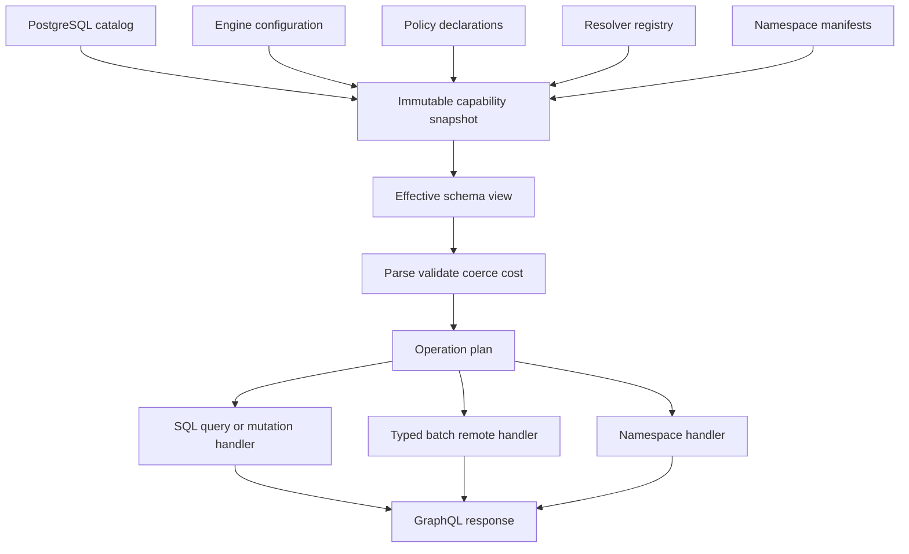
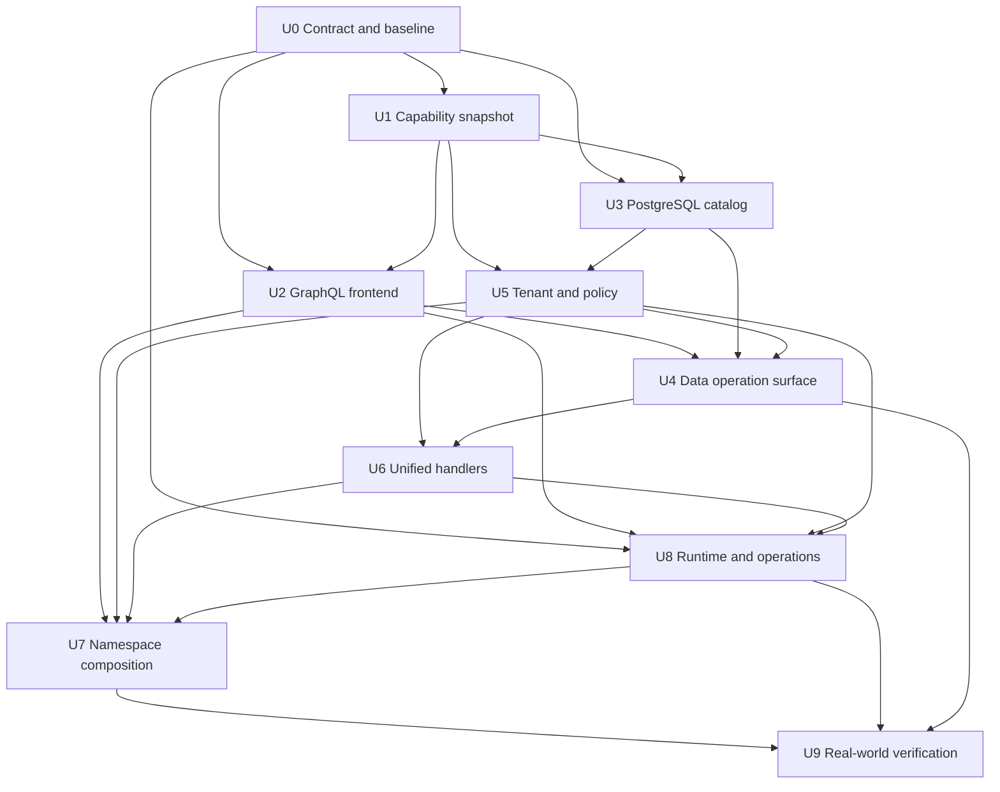
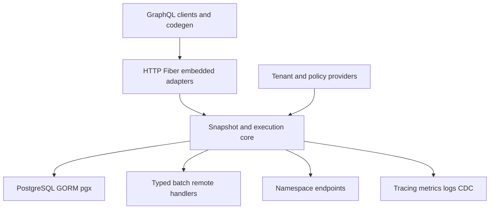

# refactor: 构建可组合的多租户 GQL 网关引擎

## Overview

将 `gql` 从已具备高性能查询能力的数据库映射库，收敛为 PostgreSQL-first、可嵌入也可独立运行、可按命名空间递归组合的 GraphQL 网关引擎。数据库目录、显式配置、策略和 Resolver 声明先合并为唯一不可变能力快照，再由同一快照驱动 Schema、自省、验证、授权、计划与执行，彻底消除“Schema 不认识但执行器接受”及“Schema 展示但执行器拒绝”的双真相。

重构保留现有单 SQL 嵌套查询、计划缓存、参数槽位、JSON 字节直通、批量 Resolver 和 Mutation 串行事务等性能优势；标准 CRUD、多租户、权限、分页、删除生命周期和审计由引擎负责，高级业务通过统一的 Typed/Batch/Remote Handler 扩展。

---

## Problem Frame

当前实现已经有较成熟的 PostgreSQL GraphQL-to-SQL 内核，但 Renderer、Metadata、策略、Resolver 声明、外部 SDL 和编译器分别推断能力，导致多个真实漂移：`@skip/@include` 可自省却未执行；批量 create/upsert 的 Input 暴露了运行时拒绝的关系操作；无 CDC 时仍生成 Subscription；治理 Loader 失败可能降级为 legacy 全开放；角色权限只在运行期拒绝而不会生成当前身份真正可执行的 Schema。

同时，核心直接耦合 GORM、Fiber、CDC、Resolver 与缓存，尚无统一身份、租户路由、能力版本或 namespace composition。继续增量堆分支会扩大重复推断和安全旁路，不符合“最少代码、紧凑易读、高内聚、低耦合、性能优先”的目标，因此允许以兼容 facade 保留公共 API，并重构内部模型。

---

## Requirements Trace

- R1. 数据库结构与约束应自动生成可执行的标准 GraphQL 查询和变更面，大部分 CRUD 不写业务代码。
- R2. Schema、自省、校验与执行必须来自同一能力事实源；任何未出现在 Schema 的特殊语法都必须在验证期拒绝。
- R3. 支持 shared-table、schema-per-tenant、database-per-tenant 三种多租户模式，并在缓存、订阅、Resolver 与远程调用中保持隔离。
- R4. 支持角色、操作、列、行、关系、聚合、写入 check/preset 的细粒度治理；生产默认 fail closed，并允许 Casbin 等策略系统通过窄接口接入。
- R5. 同时支持稳定的传统分页与 Relay 风格游标分页；分页能力、排序键和限制全部可自省。
- R6. 支持物理删除、软删除、恢复、查询删除态，以及 `created/updated/deleted at/by` 完整审计生命周期。
- R7. Query 保持单 SQL 和字节直通快路径；Mutation 保持标准顶层串行和单实例事务正确性。
- R8. 默认 SQL、Typed Resolver、Batch Resolver、Remote Resolver 使用统一 Field Handler 心智模型，并具备明确权限、事务、超时、依赖字段和错误契约。
- R9. 单实例可嵌入 Go 程序或经标准 HTTP 独立运行；GORM、Fiber、Casbin 是适配器而不是核心业务依赖。
- R10. 多个本地或远程引擎可按 namespace 组合；Query 并行，Mutation 按标准顶层顺序执行，但不承诺跨实例 ACID。
- R11. 支持不可变 Schema/Policy/Topology snapshot 原子替换、版本化缓存和 schema drift 防护；Schema/Topology 可 last-known-good，权限撤销由独立 barrier fail closed。
- R12. 具备标准错误、deadline、成本预算、背压、可观测和生产安全开关。
- R13. 保持现有 Go 公共入口兼容，并以 fish-ai-api 的 introspection artifact、真实 operation corpus、响应/错误 golden case 建立 GraphQL 兼容矩阵；安全修正必须明确标为 security-breaking，提供迁移诊断和版本/弃用窗口。
- R14. 以真实 PostgreSQL、多租户矩阵、故障注入、race/fuzz、GraphQL 合规和基准门禁证明完成度。
- R15. 只保留一份语义模型和一条主执行链；删除重复前缀推断、平行 legacy 内核与无实际能力的扩展空壳，以可测性能而非抽象数量衡量质量。

---

## Scope Boundaries

- PostgreSQL 是首个生产方言；MySQL 等方言只有实现完整能力并通过同一契约测试后才可对外展示。
- 第一版组合采用标准 Schema 中可见的 namespace 路由，不实现完整 Apollo Federation，也不复制 GraphJin 隐藏 DSL。
- 不支持跨 namespace 的自动 JOIN、filter、order、aggregate 或两阶段提交；跨实例关系由显式 Batch/Remote Handler 完成，跨实例业务一致性由 Saga/Outbox/幂等 Resolver 完成。
- 不把工作流、MCP、文件系统、对象存储或通用 API 管理平台纳入引擎核心。
- 引擎不自动猜测业务状态机、级联软删或外部副作用；这些由数据库约束或显式 Resolver/策略声明。
- 行级策略的具体条件不通过自省泄露，但当前身份可用的操作、字段、输入和参数必须在 effective Schema 中真实体现。
- 外部 SDL 只能作为带 fingerprint 的生成快照或经能力绑定校验的扩展输入，不能独立覆盖执行事实源。

---

## Success Metrics

- 标准 IntrospectionQuery 中的每个可执行 coordinate 都有且仅有一个 Handler；每个 Handler 都在 Schema 中可发现，启动期双向校验为零漂移。
- 未声明字段、参数、directive、relation operation 和 conflict target 在执行前由标准验证拒绝，零 SQL、零 Resolver 调用。
- 角色/租户轮换、计划缓存、Batch、Subscription、Remote 和连接池复用均无跨租户或跨策略泄漏。
- 无 Resolver 热查询仍为一次 SQL、保持 JSON 字节直通；现有基准的分配数量不得回退，新增网关开销有独立预算。
- 核心生产代码不保留第二套 Renderer/Policy/Operation 推断；相同概念只在 canonical catalog 定义一次。
- 所有新增公开能力均有真实 PostgreSQL 集成测试、错误路径测试和自省契约测试。
- fish-ai-api 当前公共调用可通过兼容 facade 构建；迁移后的 Resolver 与默认 CRUD 能共享外层事务。
- 三条采用者 golden path 有可执行示例与门禁：单 PostgreSQL 通过显式命名的 trusted-local 构造自动获得 CRUD；shared-table 只需一个 Identity 适配点和声明式策略；两个 Engine 只需 namespace manifest 即可组合，无需重写 Handler。生产普通 Builder 始终 fail closed。

### Baseline Gates

| Gate | Baseline / budget | Measurement |
|---|---|---|
| Warm simple query | `bc2416b` 约 1.8µs/op、22 allocs/op；alloc 不增加，ns/op 回归不超过 10% | 固定 Go/CPU，`benchstat` 比较至少 10 次样本 |
| Warm nested query | `bc2416b` 约 4.4µs/op、51 allocs/op；alloc 不增加，ns/op 回归不超过 10% | 同上，并断言一条 SQL |
| SQL count | 本地纯 SQL 查询保持 1；Batch/Remote/namespace 按计划显式计数 | 测试内 query/endpoint counter |
| Real PostgreSQL latency | U0 冻结固定数据集 P50/P95/P99；后续回归预算为 10% | 同 runner、预热、连接池和样本规模 |
| Adoption complexity | trusted-local 单库 CRUD 示例不超过当前初始化步骤；shared-table 仅新增 Identity+Policy；composition 仅新增 manifest | 示例应用 LOC、必填配置项和首次查询步骤数 |

---

## Context & Research

### Relevant Code and Patterns

- `gql/compiler/pgsql/select.go`：保留 LATERAL JOIN、选择集投影和单 SQL 查询内核。
- `gql/compiler/context.go`、`gql/cache.go`：保留参数槽位、对象池和计划缓存思路，升级隔离键。
- `gql/executor.go`、`gql/encode.go`：保留无 Resolver 的 JSON 字节直通与局部解包。
- `gql/resolver.go`、`gql/derive.go`、`gql/remote.go`：保留注册即声明、整树 Batch 和 Remote key 补投影。
- `gql/mutation_transaction_test.go`：保留单实例顶层 Mutation 串行事务契约。
- `gql/metadata_test.go`：复用 Testcontainers 真实 PostgreSQL 测试基础，改为共享容器、每测试独立 schema。
- `gql/GQL_ENGINE_ANALYSIS_REPORT.md`：保留查询快路径、Operation Plan、数据库函数/Resolver 逃生口等既有结论。

### Institutional Learnings

- `6e27ac4` 已把“Schema 展示即能力”确定为历史方向，本计划把它提升为构建期强约束。
- `f63f560` 与 `0a31456` 证明 Query 单 SQL和 Mutation 串行事务必须分治，不能为统一抽象牺牲任一侧正确性。
- `9920783`、`e04f064`、`2d89fa9` 表明权限旁路集中在统计、递归、关系、订阅与读回支路，治理必须进入统一 Plan 而不是逐路径补丁。
- `cdfed85`、`0d77661` 证明“注册即声明”和统一 Resolver 方向正确，但必须补显式 action/resource，而不是重新引入 Action 类型。
- fish-ai-api `RULES.md` 要求向后兼容；当前 go.work 指向主工作树且含用户未提交半成品，跨仓验证必须使用独立临时 workspace，不覆盖用户改动。

### External References

- [GraphQL September 2025 Specification](https://spec.graphql.org/September2025/)
- [gqlparser Releases](https://github.com/vektah/gqlparser/releases)
- [pgx Changelog](https://github.com/jackc/pgx/blob/master/CHANGELOG.md)
- [Fiber Releases](https://github.com/gofiber/fiber/releases)
- [GraphQL-over-HTTP Working Draft](https://graphql.github.io/graphql-over-http/draft/)
- [Relay Cursor Connections Specification](https://relay.dev/graphql/connections.htm)
- [PostgreSQL Row Security](https://www.postgresql.org/docs/18/ddl-rowsecurity.html)
- [PostgreSQL LIMIT/OFFSET](https://www.postgresql.org/docs/18/queries-limit.html)
- [PostgreSQL Error Codes](https://www.postgresql.org/docs/18/errcodes-appendix.html)
- [OpenTelemetry Database Spans](https://opentelemetry.io/docs/specs/semconv/db/database-spans/)
- [Apollo Router Request Lifecycle](https://www.apollographql.com/docs/graphos/routing/request-lifecycle)

---

## Key Technical Decisions

| Decision | Choice | Rationale |
|---|---|---|
| 唯一事实源 | 不可变 Capability Catalog/Snapshot | 一次定义同时驱动 Schema、验证、策略、计划、执行和文档，是减少代码与消除漂移的最高杠杆。 |
| Schema 权限 | 按结构 fingerprint + permission signature 生成 effective Schema view | 客户端自省真实反映操作和列能力，同时下游仍运行时重新授权；行条件不泄露。 |
| 公共构造 | Builder 构建并冻结 Engine，旧构造器变为兼容 facade | Build 前收集 DB、策略和 Handler，Build 后不可变，避免缓存后元数据被修改和竞态。 |
| 查询执行 | SQL Handler 保留专用单 SQL快路径 | Handler 统一的是契约与计划，不把数据库字段退化成逐字段 Resolver。 |
| Mutation | 扩展现有有序 Operation Plan；仅在测试证明需要时引入最小 write-step | 正确表达 CRUD、嵌套写、审计、策略和 readback，不预建第二套 planner。 |
| 删除 | 有 soft-delete 时 `delete` 为软删，`restore` 恢复，`purge` 独立物删；无 soft-delete 时 `delete` 物删 | 所有语义通过字段和权限出现在 Schema，避免隐藏行为；purge 可单独治理。 |
| 审计 | `*_at` 使用数据库时间，`*_by` 使用可信 Identity actor | 避免应用时钟漂移和客户端伪造；Raw SQL 不依赖 GORM callback。 |
| 分页 | offset page 与 Relay connection 分离，共享 collection plan | Schema 能表达真实参数组合；cursor 绑定完整唯一排序 tuple 和版本。 |
| 多租户 | Identity + TenantRouter + PolicyProvider 三个窄边界 | shared/schema/database 三模式共用执行链，GORM/Fiber/Casbin 仅做适配。 |
| 组合 Query | namespace 对象 + 确定性全类型前缀；不同 namespace 并行 | 解决全局类型冲突并保持标准自省与部分失败。 |
| 组合 Mutation | 顶层字段携带 namespace 前缀或单命令字段，不使用有副作用的嵌套 Mutation 对象 | GraphQL 只保证顶层 Mutation 字段串行；避免发明私有执行语义。 |
| 更新 | 离线构建 snapshot 后原子替换；Schema/Topology 失败可保留 last-known-good，撤权 barrier 不回退 | 请求固定能力版本但持续受安全 epoch 约束，避免半更新和延迟撤权。 |
| 代码规模 | 新能力必须进入既有 catalog/plan/handler 轴，并删除对应重复推断 | “少代码”通过单一语义与删除重复实现达成，不通过压缩可读性或巨大函数达成。 |

last-known-good 只适用于 Schema 与 Topology 能力更新，不适用于撤权。tenant 状态、minimum policy revision 与 credential/key epoch 组成独立原子 revocation barrier；新请求和长连接必须校验当前 barrier，安全控制面不可达或 revision 过旧时 fail closed。

### Version and Cache Contract

| Identifier | Source and scope | Required consumers |
|---|---|---|
| structural fingerprint | canonical database/catalog/type shape | effective Schema、logical plan、artifact、cursor |
| snapshot version | 一次成功 Build 的全部 handler/directive/codec/schema 内容 | request pinning、plan、prepared statement、observer |
| permission signature | 引擎对 operation/field-use 能力规范化后的抗碰撞摘要 | effective Schema、validation、APQ |
| policy revision + shape signature | Provider revision 及 row predicate/preset/check/limit/cost AST 结构 | logical/SQL plan；具体 tenant/subject 值只进入参数槽 |
| tenant route revision | 可信 TenantRouter 的 datasource/schema/catalog 映射 | SQL plan、pool、CDC；schema 名必须进入 SQL plan key |
| topology revision | endpoint identity、child fingerprint 和 namespace manifest | composed Schema、remote plan、subscription |
| selection-shape signature | coercion 后 `@skip/@include` 等影响执行的选择形状 | cost、authorization、logical/SQL plan |

每类缓存必须声明 key material、值是否包含授权结果、生命周期、容量与失效条件。Batch/DataLoader 只能 request-scoped；permission signature 不接受客户端提供值，命中时校验完整元数据而不只比较摘要。

---

## High-Level Technical Design

> 本图说明预期形状，仅作为评审方向，不是实现规范；实施者应依据测试和现有代码选择最小实现。

每个请求固定一个 snapshot、Identity、TenantRoute 和 deadline。计划缓存只包含改变结构/策略形状的 revision；tenant/user 的具体值保持参数槽。每个公开字段由 catalog 中一个 FieldSpec 绑定一个 Handler，Renderer、Policy 和 Compiler 不再通过字段名前缀重复猜测动作。

---

## Implementation Units

### Delivery Milestones

实施单元是可复用工作包，交付按以下纵向里程碑推进；每个里程碑都必须独立运行、通过真实测试、可回滚，并在进入下一阶段前提交：

1. **M1 可信单实例内核：** U0、U1、U2 的最小闭环，复用现有 CRUD/Resolver，交付 canonical snapshot、严格验证、兼容 facade 与性能门禁。
2. **M2 shared-table 生产治理：** U3/U5/U4 的必要子集，先闭环 Identity、Policy、缓存隔离、审计和删除生命周期，再扩展目录宽度。
3. **M3 可组合网关：** U6、U8 的 transport-neutral endpoint 契约和 U7，先用两个能力受限 child 证明 Query、Mutation、错误和身份传播。
4. **M4 完整数据库能力：** 补齐 Relay、复合约束、schema/database tenant、完整 catalog 和受治理订阅。
5. **M5 生产与迁移闭环：** U8/U9 的 HTTP/WS、故障治理、DDL expand/contract、fish-ai-api 迁移和全矩阵性能门禁。

- [ ] U0. **冻结兼容、依赖与性能基线**

**Goal:** 在改内核前冻结 Go/GraphQL 消费契约、真实性能和依赖行为，让每个后续里程碑都有可判定回归门禁。

**Requirements:** R13, R14, R15

**Dependencies:** None

**Files:**
- Create: `gql/testdata/compat/`, `gql/benchmark_baseline_test.go`
- Modify: `gql/go.mod`, `gql/go.sum`
- Test: `gql/bench_test.go`, fish-ai-api 独立临时 workspace 的 GQL/bot operation corpus

**Approach:**
- 保存当前 generated SDL、自省、fish-ai-api persisted/测试 operation、响应与错误 golden cases，并分类为 unchanged、security-breaking、deprecated。
- 冻结 `bc2416b` benchmark artifact、runner 参数、样本量和 SQL counter；所有阶段用同一门禁比较。
- 依赖逐个升级并分别提交：gqlparser 至少 v2.5.36 归 GraphQL conformance；pgx 至少 v5.9.2、优先当前稳定版归安全基线；Fiber 稳定 v3 只在 adapter 编译测试中升级；GORM 与 fish-ai-api 对齐。任何升级先有失败/characterization 测试，不与 snapshot 重构混在同一提交。
- 明确支持 PostgreSQL 15、16、17、18 的容器矩阵；其他版本不在首版生产承诺内。

**Test scenarios:**
- Compatibility：现有 Go API、SDL 与 operation corpus 被机器可读地盘点；有意修正项有诊断和迁移说明。
- Performance：固定 runner 可重复得到基线，门禁能用人为回归证明会失败。
- Dependency：每个升级前后行为差异被独立测试锁定，`GOWORK=off` 也能构建。

**Verification:** 后续单元不存在“测试通过但无法判断兼容/性能是否退化”的主观验收。

---

- [x] U1. **建立不可变能力快照与兼容构造层**

**Goal:** 以唯一 catalog/snapshot 取代 Renderer、Metadata、Policy、Resolver 和字段名前缀的平行能力推断；构建错误 fail-fast，Build 后冻结；保留旧公共构造 API 作为 facade。

**Requirements:** R1, R2, R11, R13, R15

**Dependencies:** U0

**Files:**
- Create: `gql/capability.go`, `gql/builder.go`, `gql/snapshot_test.go`
- Modify: `gql/metadata.go`, `gql/renderer.go`, `gql/executor.go`, `gql/protocol/class.go`, `gql/protocol/field.go`, `gql/internal/intro/introspection.go`
- Test: `gql/renderer_test.go`, `gql/introspection_test.go`, `gql/metadata_test.go`

**Approach:**
- 将数据库目录、治理配置、Codec、Resolver、Remote 和可选 namespace 声明归一化为一次性构建的 capability snapshot，并生成稳定 fingerprint/version。
- 每个 schema coordinate 显式记录类型、参数、action/resource、cost、planner/handler owner；启动时执行 Schema→Handler 与 Handler→Schema 双向检查。
- Metadata/Config/File Loader 分类为 required/optional；治理或显式文件错误必须失败，禁止 warning 后退化全开放。
- 外部 SDL 改为 snapshot artifact 或受 catalog 校验的扩展；Renderer 纯函数化，不再隐式写磁盘。
- 旧构造函数组装同一 Builder，避免保留第二套执行路径。
- 新 Builder 缺少 Policy 时 Build 失败；兼容 facade 只有显式启用 `LegacyTrustedBoundaryPolicy` 才可保留旧全开放边界，并输出启动告警和 removal metric，禁止静默降级。

**Execution note:** 先用当前虚假能力和 Loader 安全降级建立失败的 characterization/conformance 测试，再替换内部模型。

**Patterns to follow:**
- `gql/compiler.go` 的 Plan 不可变消费方式
- `gql/executor.go` 首次执行冻结注册表
- `gql/introspection_test.go` 标准自省投影

**Test scenarios:**
- Happy path：数据库表、策略和 Resolver 构建一个 snapshot，SDL、自省、验证与 Handler registry 坐标完全相同。
- Error path：权限配置引用未知列时 Build 失败，不产生 legacy Engine。
- Error path：Schema 字段无 Handler、Handler 无 Schema、重复 coordinate、类型冲突均在 Build 阶段失败。
- Edge case：Build 后修改原始 config/map 不影响 snapshot，并通过 race 测试。
- Integration：相同显式 Policy 下，旧 `NewMetadata→NewCompiler→NewRenderer→NewExecutor` 和新 Builder 生成同 fingerprint、执行同结果；未声明 trust/policy 的新 Builder 拒绝构建。

**Verification:** 所有后续能力只能通过 snapshot 注册；生产代码不再有独立字段前缀 action 推断或未校验 SDL 执行入口。

---

- [ ] U2. **补齐 GraphQL 2025 前端与错误语义**

**Goal:** 让 parse、validation、variable/literal coercion、directive、selection merge、cost 和错误完成形成唯一前端，Schema 中的标准能力均真实执行。

**Requirements:** R2, R7, R12, R14

**Dependencies:** U1

**Files:**
- Create: `gql/frontend.go`, `gql/error.go`, `gql/conformance_test.go`, `gql/frontend_fuzz_test.go`
- Modify: `gql/executor.go`, `gql/compiler.go`, `gql/resolver.go`, `gql/internal/intro/introspection.go`, `gql/encode.go`
- Test: `gql/executor_test.go`, `gql/introspection_test.go`, `gql/resolver_test.go`

**Approach:**
- 使用 effective Schema 完成 gqlparser validation，并在计划前统一完成变量 coercion、omitted/null/default 区分、fragment/field merge 和 `@skip/@include` 求值。
- 使用 snapshot 自有 validation rules 和 token-limited parser，禁止修改 gqlparser 全局 rules；严格包装其宽松 Int/enum/custom scalar coercion。
- 未实现增量交付前，从最终 Schema/Prelude 能力中移除 `@defer` 并让请求验证失败；自省补齐 `isOneOf`、`specifiedByURL`、deprecated/repeatable/default 等标准字段。
- 跳过字段不得进入授权、成本、SQL、Resolver、Remote 或响应路径。
- coercion 后生成 selection-shape signature；相同 query 在 directive 的 true/false/default/omitted 形状之间不得复用错误 logical/SQL plan。
- 统一 request error 与 execution error；execution error 携带公开 path/location/extensions.code，并按 GraphQL nullability 冒泡、保留 partial data。
- 成本分析消费规范化选择树，覆盖 alias/root/list/aggregate/recursive/remote multiplier；先提供观测模式，再启用预算拒绝。

**Execution note:** 每项标准行为使用失败的黑盒请求/响应测试先行；不得只测试内部 helper。

**Patterns to follow:**
- `gql/executor.go` 单次 parse/cache 路径
- `gql/encode.go` 流式响应处理

**Test scenarios:**
- Happy path：字段和 fragment 上的 `@skip/@include` 对字面量与变量均正确，跳过字段零副作用。
- Edge case：省略变量、显式 null、默认值、list 单值提升、未知 input 字段和 ID coercion 符合规范。
- Edge case：Int 32-bit 边界、float/string→Int、enum 大小写、nested nullable list、`@oneOf` literal/variable 和 custom scalar 均严格符合契约。
- Error path：重复 response key 类型冲突、缺必填参数、directive 未定义或位置非法在执行前拒绝。
- Error path：Resolver/DB 子字段失败产生准确 alias/list index path，Non-Null 冒泡到正确父级，兄弟字段仍返回。
- Integration：标准 IntrospectionQuery 与普通数据字段混排时结果完整；可执行 directive 集合与自省完全一致。
- Fuzz：随机 selection/fragment/variable/directive 不 panic、不越过验证、不产生无界递归。

**Verification:** 已自省的标准 directive 与输入规则均有执行闭环；未知 GraphQL 语法永远不能进入 planner。

---

- [ ] U3. **深化 PostgreSQL 目录与类型约束模型**

**Goal:** 从数据库真实推导 default、identity/generated、unique/index、check、enum/domain、array、view、复合键和关系能力，为“设计数据库即可获得正确 API”提供事实基础。

**Requirements:** R1, R5, R6, R14

**Dependencies:** U1

**Files:**
- Create: `gql/protocol/constraint.go`, `gql/metadata/loader_pgsql_catalog_test.go`
- Modify: `gql/metadata/loader_pgsql.go`, `gql/metadata/loader_base.go`, `gql/metadata/loader_config.go`, `gql/protocol/class.go`, `gql/protocol/field.go`, `gql/metadata.go`
- Test: `gql/metadata_test.go`, `gql/metadata/loader_pgsql_test.go`, `gql/metadata/loader_governance_test.go`

**Approach:**
- 把 default/generated/identity/constraint/index/function 等建成独立元数据对象，避免继续向 Field 堆互斥布尔值。
- CreateInput 必填性考虑 nullable 与数据库 default；identity/generated/read-only 不进入客户端写 input。
- unique/PK 形成类型化 conflict/key 能力；复合键使用 typed KeyInput，不再假设单 ID。
- view/materialized view 默认为只读；只有声明并验证可更新能力时才生成 Mutation。
- 生成结构 fingerprint；schema/database-per-tenant 只有 fingerprint 兼容时共享 canonical Schema 和 logical plan。
- 结构兼容只允许共享 canonical Schema 和不含标识符的 logical plan；schema-per-tenant 的可信 schema 标识符必须进入 SQL-template/plan key，首版不依赖 `search_path`，所有 SQL 使用 schema-qualified identifier。

**Execution note:** 使用真实 PostgreSQL catalog fixture 测试先行，不以静态 SQL 字符串断言替代。

**Patterns to follow:**
- `gql/metadata/loader_pgsql.go` 的 PK/FK 聚合查询
- `gql/protocol/relation.go` 的类级关系模型

**Test scenarios:**
- Happy path：identity、generated、default、enum/domain、array、unique/check、view、quoted identifier 被正确识别。
- Edge case：复合 PK/FK/unique 保持列顺序和约束身份，partial unique 不被误当通用 upsert target。
- Error path：catalog 引用不完整、冲突配置覆盖和不兼容 tenant fingerprint fail closed。
- Integration：`NOT NULL DEFAULT` 不是 CreateInput 必填；generated/identity 不可写；upsert target 只来自真实约束。

**Verification:** Renderer/Planner 不再靠字符串列名猜 conflict、key 或可写性，所有能力由 catalog 明确给出。

---

- [ ] U4. **统一分页、CRUD、删除和审计操作计划**

**Goal:** 从同一 collection/operation plan 生成传统分页、Relay connection、显式 CRUD、嵌套写、软删/恢复/purge 和六字段审计，并确保每个 Input 只展示实际可执行操作。

**Requirements:** R1, R5, R6, R7, R14

**Dependencies:** U1, U2, U3, U5

**Files:**
- Create: `gql/compiler/pgsql/audit.go`, `gql/compiler/pgsql/lifecycle_test.go`, `gql/compiler/pgsql/pagination_contract_test.go`
- Modify: `gql/renderer.go`, `gql/compiler/pgsql/select.go`, `gql/compiler/pgsql/cursor.go`, `gql/compiler/pgsql/mutation.go`, `gql/compiler/pgsql/where.go`, `gql/protocol/constant.go`, `gql/internal/config.go`
- Test: `gql/renderer_test.go`, `gql/compiler/pgsql/mutation_test.go`, `gql/compiler/pgsql/governance_test.go`, `gql/metadata_test.go`

**Approach:**
- offset page 与 Relay connection 使用不同字段/结果类型，但复用过滤、排序、投影和 collection plan；`totalCount` 仅选择时计算。
- cursor 是版本化 opaque token，绑定 coordinate、完整排序 tuple、唯一 tie-breaker、schema/policy revision；无稳定唯一顺序则不生成 cursor 字段。
- `distinct/groupBy/order/conflict` 使用实体专属 enum/input，消灭任意字符串列名。
- 按单条、批量、upsert、create/update、关系深度生成真实 Input；不支持的批量/嵌套关系操作不进入 Schema。
- 自动识别或显式配置审计六字段；数据库时钟写 `*_at`，可信 actor 写 `*_by`。delete/restore/purge 均更新对应生命周期并有独立 permission action。
- 有 soft delete 时默认查询 ACTIVE；显式 deletion enum 的 WITH/ONLY 由权限控制。
- 定义 transaction-aware `AuditWriter`；默认 PostgreSQL append-only outbox 与 purge 同事务写入，失败则业务回滚。事件使用稳定幂等键，记录 tenant/actor/action/resource/request/snapshot/policy revision 和数据库时间，不记录敏感变量；外部 sink 仅异步幂等消费，不能承担原子审计。
- 写入图不是预设的新并行 planner：先扩展现有 Mutation Operation Plan；只有失败测试证明步骤组合无法清晰表达时，才引入最小 write-step 节点。

**Execution note:** 每个能力先写“自省形状 + 真实 PostgreSQL 行状态”双断言失败测试。

**Patterns to follow:**
- `gql/compiler/pgsql/select.go` selection-driven total
- `gql/compiler/pgsql/mutation.go` MutationResult 与串行 root execution
- `std/entity.go`、fish-ai-api `RULES.md` 的审计列约定仅作为兼容输入，不进入核心依赖

**Test scenarios:**
- Happy path：offset page 的 total 为过滤后分页前总数；connection 正反向遍历返回正确 edges/pageInfo。
- Edge case：重复排序值、ASC/DESC、NULL 策略、复合键、空页、首尾页和最大 page size 稳定。
- Error path：损坏、跨实体、跨排序、跨 tenant 或旧 revision cursor 返回 `BAD_CURSOR`。
- Happy path：create/update/upsert/nested connect/disconnect/soft-delete/restore 覆盖 created/updated/deleted at/by 矩阵。
- Error path：actor 缺失、restore unique 冲突、跨租户 connect、软删行 upsert 冲突均原子失败且不泄露目标存在性。
- Integration：无软删实体 delete 物删；有软删实体 delete 标记、restore 恢复、purge 独立物删并写审计事件。
- Reliability：outbox 写入失败使 purge 回滚；serialization retry 不产生重复审计事件，普通业务角色不能修改/删除审计记录。
- Contract：批量 create/upsert 不支持 relation 时，自省中相应 Input 不包含 relation；深层 nested create 只有实际递归支持时才可达。

**Verification:** 数据生命周期、分页与输入能力全部可由 Schema 发现，执行器不存在运行期才发现的隐藏互斥或字符串列选择。

---

- [ ] U5. **建立统一身份、租户路由与策略执行**

**Goal:** 用不可伪造 Identity、TenantRouter 和 PolicyProvider 覆盖所有执行路径，并支持 built-in policy、Casbin 等外部决策器和 PostgreSQL RLS defense-in-depth。

**Requirements:** R3, R4, R11, R12, R14

**Dependencies:** U1, U3

**Files:**
- Create: `gql/identity.go`, `gql/tenant.go`, `gql/policy_provider.go`, `gql/tenant_test.go`, `gql/security_integration_test.go`
- Modify: `gql/policy.go`, `gql/scope.go`, `gql/cache.go`, `gql/compiler.go`, `gql/compiler/pgsql/where.go`, `gql/subscription.go`, `gql/cdc.go`, `gql/executor.go`
- Test: `gql/policy_governance_test.go`, `gql/role_test.go`, `gql/subscription_test.go`, `gql/metadata_test.go`

**Approach:**
- Identity 包含 tenant、subject、roles、受控 claims、policy revision 和 request id；保留 WithScope/WithRole 作为兼容注入，内部归一化为 Identity。
- Identity 只能由配置的 Authenticator、可信嵌入入口或验证后的 delegation envelope 构造；HTTP header、GraphQL 参数和客户端 claim 不得直接决定 tenant、roles 或 revision。
- TenantRouter 在解析/编译前选择 datasource/schema/catalog snapshot；schema-per-tenant 只使用可信映射，不把 claim 直接拼成标识符。
- built-in 与外部 PolicyProvider 统一产出 operation、typed row predicate、preset/check、cost/limit，以及字段用途能力 `select/filter/order/group/aggregate/join/write/return/internal-dependency`；Casbin 只做请求/动作决策，不逐行调用，Provider 禁止返回 Raw SQL。
- effective Schema view 按 structural fingerprint + permission signature 缓存；每个实例和每个 Handler 仍运行时授权。
- 支持具名 permission profile 生成版本化 schema artifact、profile 兼容 diff 和 persisted-operation 校验；运行时仍使用当前 Identity 的 effective Schema，不允许高权限 artifact 成为授权旁路。
- `PolicyDecision.ShapeSignature` 覆盖 row predicate、preset/check、limit/cost 的规范化 AST 结构并进入 logical/SQL plan key；值型 tenant/user 只有在不改变结构时才使用参数槽。
- update/delete 的行 precondition 必须进入原子 WHERE；服务端 preset 覆盖且客户端不可提交；post-state check 与 write/readback/audit 同事务。nested/bulk/upsert 的每条边重复相同策略，无权与不存在使用同一公开结果。
- Schema/validation/APQ/logical-plan/SQL-template/Remote/feed 缓存遵守统一 Version and Cache Contract；Batch/DataLoader 仅 request-scoped。
- shared-table 启动时验证租户表都有 scope 或显式 global；RLS 使用事务内局部变量并测试 owner/BYPASSRLS 风险。
- 生产 shared-table DB role 必须 `NO BYPASSRLS` 且不是 table owner，或表启用 `FORCE ROW LEVEL SECURITY`；不满足则 Build/Health fail closed。身份变量只允许事务内 `SET LOCAL`，连接在成功、取消、panic 和 retry 后均不得残留。
- tenant disable、minimum policy revision 和 key epoch 通过 revocation barrier 即时生效；Schema/Topology 可 LKG，安全撤权不可 LKG。Subscription 使用 lease、周期重授权和 revoke registry。

**Execution note:** 以跨租户缓存/订阅/连接复用泄漏测试先行；tenant 路由、Schema、operation、field-use 等 pre-execution 拒绝必须零 SQL/零 Handler。依赖数据库状态的 row check/RLS 可以执行参数化 SQL，但必须零未授权返回、零非原子副作用。

**Patterns to follow:**
- `gql/scope.go` 参数化 scope
- `gql/compiler/pgsql/where.go` role-independent SQL template
- `gql/cache.go` LRU 与 revision 扩展

**Test scenarios:**
- Happy path：shared-table、schema-per-tenant、database-per-tenant 路由同一操作到正确 datasource/schema。
- Security：两个 tenant×多个 role 轮流命中相同 query text，数据、字段、错误、Batch、feed 均不交叉。
- Error path：tenant 缺失/禁用/迁移中、策略加载失败、schema drift 均在执行前 fail closed。
- Security：统计、搜索、递归、readback、nested write、through relation、Resolver、Remote、Subscription 全部应用相同策略。
- Security：无敏感列 select 权时，filter/order/group/aggregate/cursor/join/Requires 均在 SQL 前拒绝；无权行与不存在行公开行为一致。
- Integration：Casbin 风格 provider deny/allow 与 policy revision 热更新使旧 effective Schema/plan 失效。
- Client workflow：同一客户端针对多个 permission profile 的 codegen、发布兼容检查和 persisted operation 校验可重复执行。
- Integration：连接池复用不残留 transaction-local identity；RLS owner/BYPASSRLS 配置错误被检测或测试明确失败。
- Revocation：撤权或 tenant disable 后故意让新 snapshot 构建失败，旧 APQ/plan/cursor/WS 仍不可继续使用。

**Verification:** 任一执行路径都从同一 Identity/TenantRoute/PolicyDecision 建计划，订阅 role 丢失和治理配置安全降级被消除。

---

- [ ] U6. **统一 SQL 与自定义 Resolver 的 Field Handler**

**Goal:** 让数据库 CRUD、Typed、Batch、Remote 和 namespace 字段共享同一注册/授权/计划/完成契约，同时保留 SQL 专用快路径和开发者友好的泛型 API。

**Requirements:** R7, R8, R9, R13, R15

**Dependencies:** U1, U2, U4, U5

**Files:**
- Create: `gql/handler.go`, `gql/execution_context.go`, `gql/handler_test.go`
- Modify: `gql/resolver.go`, `gql/derive.go`, `gql/remote.go`, `gql/executor.go`, `gql/compiler.go`, `gql/mutation_transaction_test.go`
- Test: `gql/resolver_test.go`, `gql/remote_test.go`, `gql/executor_test.go`

**Approach:**
- 每个 Handler 原子声明 coordinate、完整 args/result type、Query/Mutation/Subscription kind、action/resource、source dependencies、nullability、cost、timeout、transaction 与 batch/remote policy。
- Handler 默认 `RetrySafe=false`；只有纯 SQL 或显式幂等并绑定稳定 idempotency key 的完整操作才能自动重试。包含任意用户 Resolver/Remote 外部副作用时默认禁止事务自动重试，使用 outbox 或显式 Saga。
- 泛型 Resolver 继续作为主开发 API；旧 Resolver/Batch/Remote 接口由适配器注册到同一 catalog，不再创建平行分发路径。
- `Requires` 依赖字段由 planner 内部补投影，响应前剥除，客户端不必额外选择。
- ExecutionContext 提供 identity、selection、deadline、trace、snapshot 和 transaction-aware DB provider；默认 CRUD 与业务 Resolver 无需手工记忆私有 `gql.Tx` key。
- 进程内 Resolver 是受信应用代码而非安全沙箱；默认 provider 绑定当前 tenant、transaction、deadline、policy 和 datasource，原始全局连接只能通过可禁用且可审计的 `UnsafeTrusted` capability 获取。递归 Execute 必须继承身份、事务、剩余预算与 delegation chain。
- Batch 按 coordinate+args+selection request-scoped 去重并限制 batch size；Remote 下推 selection、统一超时/并发/字节上限/错误 path。
- in-process timeout 是 cooperative contract；忽略 context 的 Handler 受独立并发舱和 shutdown 管理，事务必须等待其实际退出。需要硬终止保证的扩展只能放在 Remote/process boundary。
- nil parent 不调用子 Handler；零宿主不调用 Batch/Remote；nil 与空集合、missing key、上游 partial error 均由字段 nullability 的 completion 规则唯一决定。
- `Extra(raw SDL)` 迁移为结构化类型声明；兼容期 raw SDL 必须经过 owner/handler 完整绑定校验。

**Execution note:** 先写 Resolver 作者视角的期望 API 和真实事务/错误测试，再重构内部 dispatch。

**Patterns to follow:**
- `gql/derive.go` 泛型函数签名反射
- `gql/resolver.go` 整树 host 收集
- `gql/remote.go` key 去重和内部投影

**Test scenarios:**
- Happy path：Typed nested input/output 可被标准自省和 codegen 发现，source dependency 未选择仍可供 Resolver 使用且不泄露响应。
- Happy path：Batch 整树一次调用、key 去重、结果同序；Remote 只收到声明的 selection。
- Error path：缺 action/resource 的业务 Mutation、重复 coordinate、Batch 长度不匹配在 Build 或执行时返回稳定 code。
- Error path：panic、timeout、remote partial error 按公开 path/nullability 完成，不输出 SQL/下游敏感细节。
- Integration：默认 CRUD 与根 Mutation Resolver 使用同一事务；任一步失败全部回滚。
- Integration：fish-ai-api 的 Bot service 改用 request-scoped DB provider，真实 bot Resolver 与默认 CRUD 同操作失败时一起回滚；未迁移的旧 service 不虚假承诺共享事务。
- Performance：纯 SQL 查询仍走零 Resolver 分发的字节快路径，warm plan 不做反射。

**Verification:** 开发者只有 Field Handler/Resolver 一种心智，内部仍按 SQL/Batch/Remote 执行特性优化，没有 Action 第二概念。

---

- [ ] U7. **实现标准语义的 namespace composition**

**Goal:** 组合本地或远程 Engine 为一个可自省的 Gateway，解决全局类型冲突、并行 Query、顺序 Mutation、身份传播、错误路径和 snapshot 热更新。

**Requirements:** R2, R3, R8, R10, R11, R12, R14

**Dependencies:** U1, U2, U5, U6, U8（远程路径；本地 Endpoint 可先实现）

**Files:**
- Create: `gql/gateway.go`, `gql/namespace.go`, `gql/gateway_test.go`, `gql/gateway_integration_test.go`
- Modify: `gql/capability.go`, `gql/executor.go`, `gql/error.go`, `gql/subscription.go`
- Test: `gql/introspection_test.go`, `gql/remote_test.go`

**Approach:**
- Local Engine 与 Remote Endpoint 实现 U8 定义的最小 Manifest/Schema/Execute/Subscribe/Health 契约，允许 Gateway 递归组合 Gateway。
- 每个 endpoint 有稳定 identity；topology manifest 在构建期做 DAG cycle detection、重复挂载和最大深度检查，首个有效 snapshot 前不得依赖 LKG。
- Query 根使用 `crm { ... }` 等 namespace 对象；所有 imported object/input/enum/interface/union 做确定性前缀，自定义 scalar/directive 只有契约完全一致才共享。
- composed snapshot 离线构建并校验 name/type/handler 冲突；成功后原子替换，失败保留 last-known-good。
- 同 namespace 字段合并为一个子操作，不同 namespace Query 并行；结果尽量拼接原始 JSON 片段，错误 path 前缀并重新执行公开 nullability 完成。
- Mutation 不采用有副作用的嵌套 namespace 对象；生成顶层带 namespace 的字段或单命令字段以保持规范串行。跨实例失败返回明确 partial-commit metadata，不重放已提交 Mutation。
- nullable 顶层 Mutation 字段发生 execution error 后，后续字段仍按 GraphQL 标准继续串行；只有 Non-Null 错误冒泡到 Mutation 根时才停止尚未执行字段。响应列出已提交 namespace，网络中断导致提交状态未知时返回 `INDETERMINATE_COMMIT`。
- 身份通过进程内可信上下文或短期签名 delegation envelope 传播；envelope 包含 issuer/audience/subject/tenant/受控 claims/policy+key epoch/expiry/not-before/request+operation id/delegation depth，子实例重新授权且权限取 gateway grant 与 child policy 交集。
- Subscription 公共操作与 child 操作都执行标准单根字段约束；内部 source feed 可共享，授权后的 payload 绝不跨 subscriber 共享。每个事件按 subject/claims/current revision 独立过滤、裁剪和 completion；resume token 签名并绑定 tenant、subject、coordinate、revision、offset、expiry。

**Execution note:** 使用两个同名类型 child 和可控 barrier/故障 Endpoint 的黑盒测试先行。

**Patterns to follow:**
- `gql/remote.go` JSON 拼接与字段错误处理
- `gql/executor.go` 顶层 Mutation 顺序执行
- `gql/cache.go` snapshot revision 隔离

**Test scenarios:**
- Happy path：两个 child 都有 `User/Status/Input` 时组合成功，类型名稳定、Introspection/codegen 可用。
- Performance：两个 namespace Query 通过 barrier 证明并行，同 namespace 多字段只下发一次。
- Error path：一个 child timeout/invalid response 只使对应 nullable namespace 为 null，error path/location/code 指向公开 Schema。
- Mutation：三个 namespace 顶层 Mutation 严格按文档顺序；nullable 第二字段失败时第三字段继续，Non-Null 冒泡到根时第三字段不执行，两个路径均准确标注已提交/未知状态且不自动重试。
- Security：远程 child 收到受签身份并再次拒绝越权；伪造 tenant/role header 无效。
- Security：错 audience/expiry/key epoch/delegation depth 拒绝；endpoint allowlist、TLS、redirect/DNS、fan-out、body/depth 限额和 child 响应类型重验阻止 SSRF、重放与 confused deputy。
- Snapshot：child Schema 改变时新请求原子使用新 topology，执行中请求继续旧版本；组合失败保留旧版本。
- Subscription：多 namespace 根选择按规范拒绝，单 namespace 重连与身份隔离正确。

**Verification:** Gateway 自省就是 composed snapshot，类型无冲突，查询无不必要串行，且没有跨实例 ACID 或嵌套 Mutation 的虚假承诺。

---

- [ ] U8. **拆分运行时适配并补生产治理**

**Goal:** 将核心 Engine 与 GORM/Fiber/HTTP/CDC 解耦，提供嵌入和独立运行入口，并补 timeout、SQLSTATE、成本、背压、可观测和订阅公开契约。

**Requirements:** R9, R11, R12, R13, R14, R15

**Dependencies:** U1, U2, U5, U6

**Files:**
- Create: `gql/transport/http.go`, `gql/transport/http_test.go`, `gql/observer.go`, `gql/runtime_test.go`
- Modify: `gql/fiber.go`, `gql/executor.go`, `gql/subscription.go`, `gql/cdc.go`, `gql/go.mod`, `gql/README.md`
- Test: `gql/subscription_test.go`, `gql/executor_test.go`, `gql/metadata_test.go`

**Approach:**
- Engine 暴露 transport-neutral Execute/Subscribe/Schema/Capabilities/Health；Fiber 与标准 `net/http` 只做 GraphQL-over-HTTP/WS adapter。
- 定义可本地调用也可远端承载的 Endpoint 协议：版本化 capability manifest、schema+fingerprint、execute、subscribe、health，请求/响应大小、timeout、error/extensions 与 initial-load/LKG 刷新语义固定；HTTP/WS 只是该契约的一种 wire adapter。
- Gateway 对 imported AST 做确定性双向类型/变量/fragment/directive 映射，并保留公开 query 的 error location source map；child 响应按公开 selection/type 重新校验，额外字段和内部错误不得透传。
- HTTP JSON 使用 `UseNumber` 并拒绝尾随 token，避免大整数在进入 ID Codec 前被转换为 float64；adapter 不保存池化的 Fiber context/body/header。
- GET 只允许 Query；POST/Accept/content-type/request error 与 execution error 按可版本化 HTTP policy 处理，并运行官方 audit suite。
- 提供真实公共 Subscribe；无 CDC/Notifier 能力时不生成 Subscription 字段，而不是运行期报错。
- deadline 从 HTTP→operation→remote→DB 递减，DB 使用参数化 statement/lock/idle transaction timeout；SQLSTATE 映射稳定 extensions.code，对 40001/40P01 仅重试完整安全事务。
- 自动事务重试必须消费 U6 的 RetrySafe/idempotency contract；commit 状态未知、包含外部副作用或 Handler 未声明安全时绝不透明重放。
- Observer 小接口承载 parse/validate/authorize/plan/execute/remote/DB span、metric 和结构化日志；默认不记录变量、token、cursor 明文或高基数 tenant/user label。
- 成本、response bytes、variables、batch rows、fan-out、并发、队列和 subscription feed 均有硬上限与拒绝 code。
- 保留 GORM adapter 和事务桥；核心 Handler 不依赖 GORM callback。Casbin/Fiber 适配不污染 catalog/plan。

**Execution note:** transport 黑盒、超时/故障注入和订阅泄漏测试先行。

**Patterns to follow:**
- `gql/fiber.go` 现有请求封装
- `gql/subscription.go` 共享 feed
- `gql/cdc.go` WAL notifier

**Test scenarios:**
- HTTP：POST JSON、Accept、GET Query、GET Mutation 405、解析/验证/执行错误分层符合策略。
- Capability：无 notifier 时 Schema 无 Subscription；配置后公共 Subscribe 与 WS 使用同一执行链。
- Capability：无任何 executable subscription source 时 Schema 无 Subscription；source 可以是 CDC/Notifier、显式 Subscription Handler 或可订阅 child。
- Reliability：statement timeout、lock timeout、serialization/deadlock、连接断开、remote deadline 返回稳定 code 且事务状态正确。
- Security：日志/span/metric 不包含 token、变量或高基数 identity；订阅重连不跨 tenant/role。
- Backpressure：过大变量、batch、response、fan-out、并发和成本在预算边界稳定拒绝。
- Integration：GORM 与直接 PostgreSQL adapter 执行相同 operation contract；Fiber 与 net/http 返回相同 GraphQL body。

**Verification:** 核心可在无 Fiber 的程序中嵌入，也可用标准 HTTP 独立运行；生产故障均有超时、错误码和观测信号。

---

- [ ] U9. **建立真实复杂验收、性能门禁与迁移闭环**

**Goal:** 用真实 PostgreSQL、多租户、多实例、下游兼容和持续基准证明完整引擎；删除被新内核替代的重复代码，完成文档和迁移。

**Requirements:** R1-R15

**Dependencies:** U4, U5, U6, U7, U8

**Files:**
- Create: `gql/integration_gateway_test.go`, `gql/security_matrix_test.go`, `gql/benchmark_gateway_test.go`, `gql/testdata/complex_schema.sql`, `gql/MIGRATION.md`
- Modify: `gql/README.md`, `gql/GQL_ENGINE_ANALYSIS_REPORT.md`, `gql/examples/main.go`, `gql/bench_test.go`, `gql/compiler/pgsql/bench_test.go`
- Test: all `gql/**/*_test.go`

**Approach:**
- Testcontainers 使用共享 PostgreSQL、每测试独立 schema；覆盖 identity/default/generated/enum/domain/check/unique/复合键/view/审计/软删与 RLS。
- 建立 role×tenant×operation×field×relation×subscription×resolver 安全矩阵，以及两个本地/远程 namespace 的故障和 partial commit 测试。
- 增加 race、fuzz、GraphQL-over-HTTP audit、schema snapshot drift 和支持 PostgreSQL 版本矩阵。
- 固化 byte fast path、compile、warm cache、real PG、governed mutation、Batch/Remote、namespace fan-out 基准；比较 SQL 次数、alloc、P50/P95/P99 和响应字节。
- 对最近变更做多轮 simplify/code review，删除 legacy 推断与 facade 内重复实现；兼容 facade 只转发新内核。
- 在不触碰 fish-ai-api 用户未提交工作树的前提下，使用独立临时 workspace 验证其 GQL 模块与 bot Resolver；记录后续应用侧 Identity/transaction provider 迁移。
- 把 fish-ai-api Identity/Policy 注入和 Bot service transaction-aware DB provider 作为正式迁移，而不是仅记录后续工作；先迁应用再关闭显式 `LegacyTrustedBoundaryPolicy`，回滚顺序相反。
- 建立数据库 expand/contract 流程：additive DDL → 同时兼容旧/新的 snapshot → 原子切流并排空旧请求/订阅/prepared plan → destructive cleanup；定义 tenant migration cohort、失败回滚与最小兼容版本。

**Execution note:** 本单元以端到端验收矩阵为完成标准，不允许用单元测试通过替代真实数据库、跨实例和故障路径。

**Patterns to follow:**
- `gql/metadata_test.go` Testcontainers
- `gql/bench_test.go` 字节快路径基准
- `gql/examples/main.go` 可运行能力示例

**Test scenarios:**
- Integration：完整复杂 schema 经 introspection/codegen 产生的操作全部执行成功，未展示能力全部验证失败。
- Security：相同热计划交替执行多个 tenant/role，不泄漏 data/error/cache/feed；RLS 与应用策略双层隔离。
- Namespace：并行 Query、同 namespace 合并、远程 timeout、error path、snapshot reload、顺序 Mutation/partial commit 全链闭环。
- Compatibility：旧构造 API、Resolver、Codec、Fiber plugin 与 fish-ai-api GQL 消费面可构建并通过目标测试。
- Compatibility：兼容矩阵中的真实 GraphQL operation、response/error golden case 逐项通过；security-breaking 与 deprecated 项给出可机器读取的迁移诊断。
- Migration：expand/contract 在旧请求、滚动 tenant migration 和 destructive DDL 故障下不执行错误 snapshot/plan。
- Performance：本地嵌套查询保持一条 SQL和字节直通；新增治理/namespace 开销满足基准预算，无 N+1。
- Reliability：race、fuzz、故障注入、全量测试、静态检查均无错误或不稳定重试。
- Compatibility：Go 1.25/1.26、支持的 PostgreSQL 版本和 Fiber 稳定 adapter 进入测试矩阵；不在存在已知安全修复缺口的 pgx 版本上发布。

**Verification:** 所有 requirements 有自动化证据；文档、Schema、运行行为与性能报告一致；没有待办式生产阻断项或隐藏能力。

---

## System-Wide Impact

- **Interaction graph:** 认证适配器先构造 Identity；TenantRouter 选择 snapshot/data source；effective Schema 完成验证；OperationPlan 调度 SQL/Resolver/Namespace；完成层合并 data/errors；Observer 记录低基数信号。
- **Error propagation:** 构建期配置/Schema/Handler 冲突 fail-fast；request error 不执行；execution error 按 path/nullability 部分返回；跨实例 Mutation 明确 partial commit；内部 SQL/服务细节默认脱敏。
- **State lifecycle risks:** snapshot、plan、feed、prepared statement 和 connection identity 必须按 revision/tenant mode 隔离；热更新原子切换；Mutation 重试、outbox 和 purge audit 防重复/丢失。
- **API surface parity:** 嵌入 Execute/Subscribe、标准 HTTP、Fiber、Resolver 内调用和 namespace child 必须消费同一 Engine；旧 API 只做 facade。
- **Integration coverage:** 单元测试无法证明数据库 catalog、RLS、连接池、Mutation 事务、CDC、远程 timeout 和组合错误，必须由真实 PG/多实例测试覆盖。
- **Unchanged invariants:** 选择集驱动单 SQL、参数化 SQL、默认 limit/max depth、持久化查询、Codec 字节改写和 Resolver Batch 不得因重构退化。

---

## Open Questions

### Resolved During Planning

- Mutation namespace 表达：采用标准顶层带 namespace 的字段/单命令字段，不把副作用放入嵌套对象。
- 权限与自省：采用 effective Schema view 裁剪操作/列，运行时每节点仍授权；不在自省泄露行条件。
- 删除语义：soft-delete 实体的 delete 为软删，purge 为独立物删；无 soft-delete 的 delete 物删。
- 多租户范围：三种模式共用 TenantRouter，shared-table 是首个完整性能路径。
- 跨实例事务：不实现 2PC；公开 partial commit，复杂业务使用 Resolver + Saga/Outbox。
- 兼容策略：旧公开 API 保留为 facade，内部只保留新 Engine 一条执行链。

### Deferred to Implementation

- 升级后锁定版本（至少 gqlparser v2.5.36）已覆盖的 validation/coercion 细节与引擎需补的最小层：通过该锁定版本源码和 conformance 失败结果决定，避免重复实现库已有功能。
- cursor 的签名算法和 token 具体布局：在安全、长度和分配基准下选择，公开契约仅承诺 opaque/versioned/bound。
- PostgreSQL catalog 单查询还是少量分层查询：以真实启动基准和可读性决定，不牺牲正确性。
- 旧字段命名的 deprecation 周期：先由兼容测试列出真实 fish-ai-api 消费面，再决定只保留 facade 还是生成 deprecated schema aliases。

---

## Alternative Approaches Considered

- 继续在 Renderer/Compiler/Policy 上逐项补功能：改动短期小，但每个能力需在多处重复推断，无法保证自省一致或最少总代码，拒绝。
- 全部改成逐字段 Resolver：概念统一但丢失单 SQL、字节直通和计划缓存优势，拒绝。
- 直接采用完整 Federation：解决通用 subgraph 生态但增加 directive、entity representation、router 兼容和运维表面积；namespace 已满足当前产品目标，推迟。
- 把所有权限交给 Casbin 或 PostgreSQL RLS：单独任何一层都不能同时生成 effective Schema、列权限、输入 preset/check 和跨实例策略；采用窄 Provider + SQL/RLS 防御纵深。
- 跨实例两阶段提交：复杂、脆弱且与常见 HTTP 子图不兼容；使用明确 partial commit 和业务 Saga/Outbox。

---

## Risks & Dependencies

| Risk | Likelihood | Impact | Mitigation |
|---|---|---|---|
| Snapshot 重构破坏查询热路径 | Medium | Critical | 先固化 benchmark/characterization；catalog 只在 Build/更新期使用，warm request 只读紧凑索引。 |
| 兼容 facade 变成第二套内核 | Medium | High | facade 只能参数转换并委托 Builder/Engine；架构测试禁止旧 planner/renderer 分支。 |
| 角色 Schema 造成缓存爆炸 | Medium | High | 按 permission signature 而非 user/tenant 值缓存，限制 view 数并观测命中率。 |
| schema/database tenant 结构漂移串计划 | Medium | Critical | structural fingerprint + datasource/schema revision；不匹配即独立 snapshot 或 fail closed。 |
| namespace Mutation 误导为全局事务 | Medium | Critical | 顶层标准字段、partial-commit code/metadata、禁止透明重试，文档和测试明确。 |
| Resolver 绕过事务/权限 | High | Critical | ExecutionContext DB provider、显式 action/resource、每 Handler 授权、真实事务测试。 |
| 订阅共享 feed 跨角色泄漏 | High | Critical | 修复前治理 Subscription 不可见；完整 identity/revision feed key 与重连测试。 |
| Catalog 读取影响启动时间 | Medium | Medium | 支持带 fingerprint 的生成快照；共享 testcontainer；测量 catalog 查询与冷启动。 |
| 标准 GraphQL 完成层增加分配 | Medium | High | 纯 SQL 成功响应继续 raw fast path；仅错误/Handler/namespace 路径进入结构化完成。 |
| 代码量因适配器和兼容层膨胀 | Medium | High | 单一 catalog/plan/handler、阶段性 simplify、删除旧推断；适配器只做协议转换。 |
| fish-ai-api 主工作树有用户未提交改动 | High | High | 不修改该工作树；使用独立临时 workspace/replace 验证，迁移单独提交。 |
| GraphQL-over-HTTP 尚为工作草案 | Medium | Medium | HTTP policy 集中可版本化，运行官方 audit，不把状态码散落核心。 |

---

## Documentation / Operational Notes

- README 以“数据库约束→Schema→执行”的真实示例解释分页、删除、审计、权限和 Resolver，不列尚未实现能力。
- 生成并发布 schema artifact、fingerprint、engine capabilities 和 migration guide；自省关闭时 artifact 必须来自同一 snapshot。
- 记录 shared/schema/database tenant 的连接池、迁移、CDC、RLS 与 schema drift 运维要求。
- 记录跨 namespace Mutation 非 ACID、partial commit、幂等和 Saga/Outbox 责任边界。
- 公开稳定 error code、SQLSTATE 映射、timeout/cost 默认值和监控指标，敏感字段默认脱敏。

---

## Sources & References

- Related code: `gql/README.md`, `gql/GQL_ENGINE_ANALYSIS_REPORT.md`, `gql/renderer.go`, `gql/executor.go`, `gql/policy.go`, `gql/resolver.go`, `gql/compiler/pgsql/`, `gql/metadata/`
- Related history: `6e27ac4`, `f63f560`, `0a31456`, `9920783`, `cdfed85`, `0d77661`, `bc2416b`
- External docs: GraphQL September 2025, GraphQL-over-HTTP draft, Relay Cursor Connections, PostgreSQL 18 security/error/timeout docs, OpenTelemetry semantic conventions, Apollo Router lifecycle
