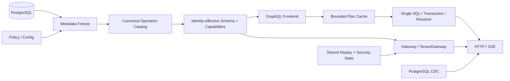

# GQL 引擎 GA 就绪度全面评估

> 历史评估：以下结论对应当时基线。当前版本以 [2026-09-05 生产订单验证](docs/reviews/2026-09-05-production-order-validation.md) 的实测范围、迁移要求和发布判断为准。

> 最终复评日期：2026-08-16  
> 分支：`optimize/gql-engine-five-round-simplification`  
> 基线：`115a7c5354c9af0936e36c8bec38e56dae7d6fbb`  
> 范围：`gql` 模块全部生产 Go 代码、公开 API、GraphQL/HTTP/SSE 协议、数据库编译、权限、租户、集群、测试、CI 与文档  
> 工作树状态：实现和本报告均未提交，供人工 review

## 1. 最终结论

**判定：达到 GA 代码标准，可以进入发布流程。**

上一版报告列出的 G-01～G-21、H-01～H-14 已全部关闭；随后又进行了全生产代码的 correctness、security、reliability、performance、API contract、maintainability 和 agent-native 复审，终审发现的嵌套关系 FK 授权、有效 Schema 身份绑定、Resolver AST 隔离、CDC 单契约及安全快照重复加载也已修复。

本次 GA 的含义是：引擎代码和自动门禁已经具备正式发布条件。发布仍需遵循第 8 节的部署前提，并在目标生产拓扑持续执行容量基准、灰度和回滚演练。

架构已经收敛为一条主链：

不存在第二套执行器、第二套权限 DSL、隐藏 GraphQL 参数或旁路能力协议。数据库 CRUD、Resolver、远程 namespace 和订阅都从同一个冻结快照及能力目录派生。

## 2. 规模与验证基线

### 2.1 代码规模

| 指标 | 数量 |
|---|---:|
| 生产 Go 文件 | 88 |
| 生产 Go 代码 | 27,231 行 |
| 测试 Go 文件 | 128 |
| 测试 Go 代码 | 21,664 行 |
| Test | 666 |
| Fuzz | 1 |
| Benchmark | 18 |

生产复杂度主要位于 SQL mutation、Gateway composition、Executor、Resolver、effective schema、policy runtime 和 subscription/CDC 状态机。这些复杂度对应真实协议与数据库语义；公共 helper 只保留 LRU、shared flight、健康聚合、执行上下文等已重复出现且可独立验证的机制。

### 2.2 最终动态门禁

环境：Go 1.26.6、darwin/arm64、真实 PostgreSQL 15 容器。

| 门禁 | 最终结果 |
|---|---|
| `go test ./... -count=1` | 全部通过；最终根包 29.671s |
| `go test -race ./... -count=1` | 全部通过；根包 52.520s |
| `go vet ./...` | 通过 |
| `gql/tools: GOWORK=off go test ./...` | 通过 |
| allocation budgets | 通过 |
| executable frontend fuzz 10s | 通过；211,968 executions |
| `govulncheck ./...` | 0 个可达漏洞；3 个 imported/6 个 required 信号均不可达 |
| 多进程 replay/security/revision | 通过 |
| HTTP RemoteEndpoint → Gateway 多进程状态变化 | 通过 |
| 真实 PostgreSQL mutation SQL count | 通过 |
| 真实 PostgreSQL concurrent warm gate | 通过 |

真实 PostgreSQL warm query：

| 指标 | 结果 | GA 门限 |
|---|---:|---:|
| 并发 / 请求 | 8 / 64 | 固定场景 |
| 吞吐 | 3,243.8 req/s | ≥ 500 req/s |
| P50 | 572.959µs | 观测 |
| P95 | 14.056ms | 观测 |
| P99 | 15.347ms | ≤ 100ms |
| 分配 | 65 alloc/request | ≤ 100 |
| SQL | 1 SQL/request | = 1 |
| 错误 | 0 | = 0 |

CI 已覆盖 PostgreSQL 15/16/17/18 correctness matrix、race、fuzz、govulncheck、allocation、base/head benchmark、真实 PostgreSQL SQL/并发门禁及真实多进程集群合同。

## 3. GA 成熟度评分

所有维度均达到要求的 8.5 分以上。

| 维度 | 分数 | 依据 |
|---|---:|---|
| 核心架构与单路径 | 9.2/10 | catalog → effective artifact → frontend → plan → execution 唯一主链 |
| 数据库映射与 CRUD | 9.1/10 | catalog、关系、分页、聚合、完整生命周期、审计与无字段 create |
| GraphQL 标准语义 | 8.9/10 | 标准 validation/coercion/directive/completion、Mutation 顺序、兼容 diff |
| 安全与细粒度权限 | 9.1/10 | operation/row/field/preset/check、RLS、identity pin、replay、撤权、零 SQL 拒绝 |
| 多租户与多实例 | 8.9/10 | database/shared-table、route revision、共享安全状态、远程 snapshot pin |
| 性能架构 | 8.8/10 | 单 SQL、有界缓存/准入/fan-out、singleflight、真实性能硬门禁 |
| 可靠性与故障隔离 | 8.8/10 | deadline、重连、背压、CDC 状态、LKG、降级与故障注入 |
| 自省与能力发现 | 9.1/10 | SDL、Capability、persisted catalog、semantic kind、transport descriptor 同步 |
| Resolver 扩展性 | 9.0/10 | Query/Mutation/Field 一种心智、统一 ExecutionContext、Batch 与事务 |
| 可维护性/不可变性 | 8.8/10 | 冻结 metadata、factory dialect、私有协议表、单 CDC 契约、核心依赖拆分 |
| 测试与 GA 门禁 | 9.2/10 | 664 tests、race/fuzz/漏洞/PG 矩阵/多进程/真实性能 |
| **综合** | **90/100** | **GA** |

评分保留余量的原因不是已知发布阻断，而是生产拓扑、数据规模和 SLO 仍需由实际部署持续验证。

## 4. 能力完整性

### 4.1 数据库到 GraphQL

| 能力 | 状态 |
|---|---|
| PostgreSQL catalog | 表、视图、列、PK、unique、FK、check、index、enum/domain、array、routine |
| 自动 Schema | 查询、输入、过滤、排序、统计、分页、关系和生命周期从同一 catalog 生成 |
| 传统分页 | offset/limit，空页 total 从过滤全集计算 |
| 游标分页 | keyset、稳定排序、PK 兜底、schema/policy revision 绑定 |
| 查询 | 选择驱动、关系嵌套、聚合、全文检索、单 SQL |
| Create | 单条、批量、嵌套 create、纯默认/生成列 `DEFAULT VALUES` |
| Update/Delete | 行过滤、返回值、软删除、物理 purge、原子事务 |
| Upsert | unique conflict target、insert/update 双权限与双 check |
| Restore/Purge | 显式 operation、自省可见、purge audit outbox |
| 关系写入 | 可安全证明时生成 connect/disconnect/nested create；不支持的形态不进入 Schema |
| 审计 | created/updated/deleted at/by，preset/check 与 mutation 同事务 |

### 4.2 权限和多租户

- `Builder.Policy` 是 PolicyProvider 唯一装配入口；配置错误 fail-fast。
- operation、row predicate、field use、preset、check 使用同一 typed decision。
- 主键、复合 key、关系目标 key、自动写入的一对多 FK 均进入字段授权。
- effective schema 与 capability 对当前身份同步裁剪，拒绝不依赖运行期猜测。
- shared-table 使用 tenant scope + RLS；database-per-tenant 使用原子 TenantRouter snapshot。
- delegation 签名绑定 identity、可信 scope、operation、snapshot、depth、epoch 和 replay JTI。
- PostgresReplayStore 与 PostgresSecurityStateProvider 为多副本提供共享事实源。
- health 暴露 control/route/security revision、database、CDC state 和 degradation。

### 4.3 Resolver 与扩展

- `Query`、`Mutation`、`Field` 只是同一 Resolver 定义模型的意图明确入口，没有 Action 第二概念。
- Resolver 从 `ExecutionContextFromContext` 获得身份、scope、route、policy decision、capability、snapshot、事务 DB 和提交后 invalidation。
- Selection 返回完全脱离缓存 AST 的副本，业务代码误修改不会污染计划或制造竞态。
- 默认 Query 根字段保持合并 SQL；Resolver 字段独立执行；Mutation 顶层按 GraphQL 顺序执行并共享事务。
- Batch Resolver 和 Remote Handler 避免结果树 N+1。
- Capability 的 semantic kind 区分 primitive、projection、command 和 workflow；自动化客户端无需猜测 Handler 语义。

## 5. GraphQL、自省与协议诚实性

引擎只暴露真实可执行能力：

- schema validation、变量/字面量 coercion、`@include/@skip`、Non-Null bubbling、fragment completion 均执行标准语义。
- 无 CDC source 时不生成 Subscription；不可证明安全的 relation/upsert/purge 不生成对应字段。
- identity-effective artifact 同时携带 SDL、Capabilities、execution mode、persisted operations、identity descriptor、policy/route revision 和 execution pin。
- SchemaArtifact 只接受 `schema-artifact-v2`，不存在身份校验较弱的 legacy 双路径。
- `ExecutionPin` 绑定完整 artifact；父 Gateway 和 RemoteEndpoint 都验证 artifact 与调用身份。
- manifest、health、effective-schema、problem error 和 transport descriptor 都有版本化 wire contract。
- production persisted-only 模式在 artifact 中给出允许 operation name/type/hash/variables，不再出现“能看到但不能调用”。
- schema compatibility 门禁覆盖字段、参数、input、enum、union membership 和 interface implementation，并给出结构化 breaking coordinates。

标准 GraphQL introspection 负责 GraphQL 类型能力；身份有效 artifact 是成本、重试、幂等、semantic kind 和 transport 信息的唯一治理发现入口。这是职责分层，不是隐藏语法。

## 6. 性能与容量架构

- 默认 CRUD 的 flat/nested query 和 mutation 保持参数化单 SQL。
- 无 Resolver 响应走 JSON bytes 直通；有 Resolver 时只解包需要后处理的部分。
- plan、effective schema、remote artifact、snapshot history 和 subscription feed 均有界。
- 冷 miss 使用实例级 shared flight 和有界 build limiter；不合作的 child 也受 deadline 和槽位约束。
- Gateway namespace fan-out、Remote unary、HTTP admission、SSE subscriber、feed、tenant feed、document、response 和 mutation work 均有硬上限。
- Remote effective artifact 使用身份键、本地 TTL LRU、provider cache identity 和 parent composition cache；warm path 不重复拉 schema。
- subscription key 为定长摘要；payload 在长期保存前执行响应上限。
- tenant refresh 先取租户槽、再取全局槽，避免单租户占满共享资源。
- 性能 CI 同一 runner 比较 base/head，allocation/SQL count 用确定性硬预算，延迟使用统计门禁。

## 7. 可靠性和故障模型

- 所有数据库、child health、Remote unary/SSE、subscription refresh 和 lease 都有 deadline。
- health 子探测并发有界；进程 readiness、route-scoped readiness 与 aggregate degradation 分离。
- CDC publication 在启动时校验；状态明确区分 `IdleValidated`、`Connected`、`Disconnected`。
- notifier 编译期要求 watch/unwatch、health state、commit invalidation 和 close，不存在“假健康/漏通知”兼容分支。
- pgoutput parse error 触发连接重建与全量唤醒收敛；CDC 明确定义为 latest-state notification，不是事件日志。
- SSE 客户端支持限次退避重连、握手取消、idle watchdog；服务端有 heartbeat、写 deadline 和写错误传播。
- feed 在完整 fetch/unpack 成功后才提交指纹，临时 Resolver 错误不会吞掉后续恢复结果。
- Gateway update 使用单调 revision、冲突检测、原子 publish、LKG 与历史 snapshot 窗口。
- child fan-out 错误使用取消隔离，迟到或忽略 context 的 child 不阻塞健康 namespace 返回。

## 8. 多实例部署合同

### 8.1 已验证

- 跨进程 delegation replay 只能消费一次。
- security/policy/credential/route revision 可被其他进程观察，并能在活动服务期间撤权。
- stale control revision 被拒绝，已发布的新状态不回滚。
- RemoteEndpoint → Gateway 通过真实 HTTP 完成 manifest、effective artifact、执行和状态变化。
- 请求与订阅固定 structural snapshot 和 identity-effective execution pin。

### 8.2 强制生产前提

1. 所有副本应用 `PostgresReplayDDL`、`PostgresSecurityStateDDL` 和 purge audit outbox DDL；readiness preflight 必须通过。
2. 多副本使用共享 ReplayStore/SecurityStateProvider，不得使用进程内 store 作为安全事实源。
3. metadata artifact、policy revision、route revision、Gateway revision 和 delegation key epoch 由控制面一致发布。
4. PostgreSQL 开启 `wal_level=logical`；publication 覆盖所需表；复制账号使用最小权限。
5. shared-table 模式账号必须 NOBYPASSRLS，且不是绕过策略的 superuser/owner，或显式 FORCE RLS。
6. 新副本接流量前通过 migration、security state、database、snapshot 和 CDC readiness。
7. 跨 namespace Mutation 没有分布式事务；调用方使用幂等、对账与补偿处理 committed/indeterminate 结果。
8. CDC 是 latest-state 唤醒，不承担不可丢事件、审计日志或消息队列职责。

## 9. 原报告问题关闭矩阵

### 9.1 G-01～G-21

| ID | 状态 | 落地结果 |
|---|---|---|
| G-01 | 已关闭 | PK、复合 key、关系 key 和自动 FK 统一进入 FieldUseFilter/Write |
| G-02 | 已关闭 | publication 严格 PostgreSQL identifier 验证与安全引用 |
| G-03 | 已关闭 | nested mutation 递归 work/cost/row/parameter 预算 |
| G-04 | 已关闭 | filtered total 与 page 分离，空页 total 正确 |
| G-05 | 已关闭 | 标准 typename、inline fragment 和递归 completion |
| G-06 | 已关闭 | subscription refresh/lease 独立 deadline |
| G-07 | 已关闭 | tenant-first、公平且逆序释放的 refresh admission |
| G-08 | 已关闭 | Remote TTL LRU、cache identity、singleflight、有界 child fan-out |
| G-09 | 已关闭 | HTTP body 前准入、队列上限、Retry-After |
| G-10 | 已关闭 | subscription 有界编码和常量级超限结果 |
| G-11 | 已关闭 | mixed default Query roots 合并为一个 SQL |
| G-12 | 已关闭 | Dialect registry 注册 factory，每次 Build 独立实例 |
| G-13 | 已关闭 | 协议表私有不可变，metadata 解码使用独立副本 |
| G-14 | 已关闭 | trusted scope 进入版本化 delegation envelope |
| G-15 | 已关闭 | Remote 统一解码 200/503 versioned health |
| G-16 | 已关闭 | persisted-only mode/catalog 纳入 artifact 与 pin |
| G-17 | 已关闭 | feed key 改定长 digest，并限制 document/variables |
| G-18 | 已关闭 | limiter 下沉实例并分租户隔离 |
| G-19 | 已关闭 | scope 注入和读取均深拷贝 |
| G-20 | 已关闭 | CI required job 执行真实 PG concurrent warm gate |
| G-21 | 已关闭 | SQL shape compatibility 为普通确定性 Test |

### 9.2 H-01～H-14

| ID | 状态 | 落地结果 |
|---|---|---|
| H-01 | 已关闭 | CDC 三态健康模型 |
| H-02 | 已关闭 | Gateway 构建期校验 health capability/interface 一致 |
| H-03 | 已关闭 | PostgreSQL security snapshot 原子缓存与最大陈旧窗口 |
| H-04 | 已关闭 | performance tooling 拆到 `gql/tools`；集成测试移除 testcontainers 图 |
| H-05 | 已关闭 | versioned health/manifest/descriptor 和稳定错误码 |
| H-06 | 已关闭 | 显式 read snapshot primitive，不隐式承诺一致快照 |
| H-07 | 已关闭 | capability 暴露 refreshRequired/read-after-write |
| H-08 | 已关闭 | Resolver ExecutionContext 提供 commit-after invalidation |
| H-09 | 已关闭 | 纯默认/生成列实体支持 create |
| H-10 | 已关闭 | ExecutionContext 统一 scope/route/policy/capability/DB 视图 |
| H-11 | 已关闭 | 非敏感 IdentityDescriptor 纳入 execution pin |
| H-12 | 已关闭 | route readiness 与 aggregate degradation 分离 |
| H-13 | 已关闭 | Capability SemanticKind 区分原语和工作流 |
| H-14 | 已关闭 | 版本化 transport descriptor 支持客户端发现 |

## 10. 可维护性与最少心智

已完成的单路径收敛：

- Resolver/Action 统一为 Resolver；公开入口仅 `Query`、`Mutation`、`Field` 意图命名。
- Resolver 数据库、事务、身份和失效只通过 `ExecutionContext`，删除平行 context helper。
- artifact 只支持 v2；不保留安全语义较弱的兼容执行路径。
- HTTP 和 SSE 共享 delegation、snapshot、execution-pin 请求准备逻辑。
- core 与 Remote 共用有界 LRU；effective build 共用 context-aware shared flight。
- notifier 一个私有接口覆盖健康和失效；PostgreSQL security snapshot 只有一个加载/解码实现。
- map 排序、health aggregation、capability clone、policy decisions 等重复算法已收敛。
- `gql/tools` 隔离性能工具依赖，核心模块不再携带 x/perf/testcontainers/OTel 工具链。

不建议继续为了行数内联 SQL compiler、Gateway composition 或 subscription 状态机。它们是安全和协议边界，保留局部命名函数比抽象成通用策略框架更容易审计，也不会增加运行时分派。

## 11. Agent-native 评价

引擎定位为确定性数据工具层，而不是 agent runtime：

- 自动生成 CRUD、relation、aggregate、restore/purge 等细粒度数据原语。
- 自定义 Handler 通过 semantic kind 明确声明 primitive/projection/command/workflow。
- identity-effective capability artifact 是 agent 获取权限、成本、重试、幂等和执行方式的唯一治理入口。
- transport descriptor 给出 manifest/effective/execute/subscribe/health 端点及认证合同。
- Resolver workflow 不会伪装成自动 CRUD 原语；GraphQL operation 由外部 agent 动态组合。
- 错误在 GraphQL、HTTP、SSE、health 和 control plane 均有稳定 code/category/retryable 语义。

Agent-native 评分由上一版约 82% 提升到 **91%**。剩余空间主要是应用自定义 Handler 的组织治理，不能由通用数据库引擎替业务代码自动证明。

## 12. 已知边界与发布后观察项

以下不是 GA 缺陷，而是明确产品边界：

1. 跨 namespace Mutation 不提供分布式事务。
2. CDC 提供 latest-state 收敛，不保证逐事件交付。
3. nested update/delete 和无法安全证明的复合关系写入不会生成，属于自省诚实性。
4. 远程或自定义 workflow 的业务正确性仍由 Handler 所有者负责；引擎负责权限、上下文、成本和协议边界。
5. 本地 64 请求性能样本证明门禁有效，不等同于目标硬件的生产 SLO；发布时仍需固定数据集 soak、容量和故障演练。
6. 目标环境需持续跟进依赖中当前不可达的漏洞信号，升级前重新执行 govulncheck 与兼容矩阵。

建议首个 GA 灰度持续观测：plan/effective cache hit rate、DB phase、SQL count、HTTP admission rejection、Remote retry、CDC outage duration、feed count、degraded sources 和 revision convergence。

## 13. 最终发布门禁

当前代码已满足：

- P0 = 0，P1 = 0；终审高置信问题全部有回归测试。
- 静态权限/格式/准入拒绝在 SQL 或 Handler 前完成；依赖行状态的拒绝保持原子、无未授权返回。
- GraphQL schema、自省、Capability 与执行合同一致。
- PostgreSQL 15–18、race、fuzz、govuln、cluster、fault 和 performance 已成为自动门禁。
- 多实例 replay、撤权、revision 和远程组合已有真实进程/HTTP 测试。
- 文档明确 metadata freeze、RLS、DDL、CDC 和跨 namespace 事务边界。

**最终结论：GA Go。**

代码和报告均保持未提交，等待人工 review 后再决定提交与发布。
